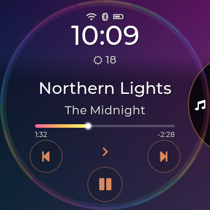
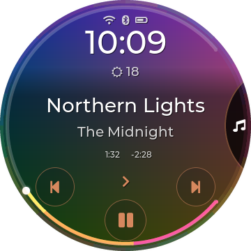
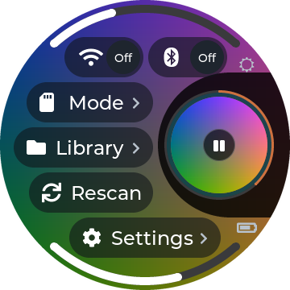
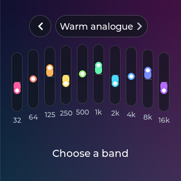
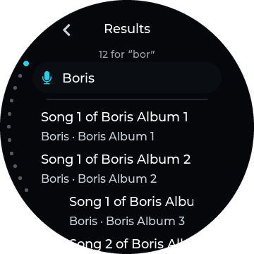
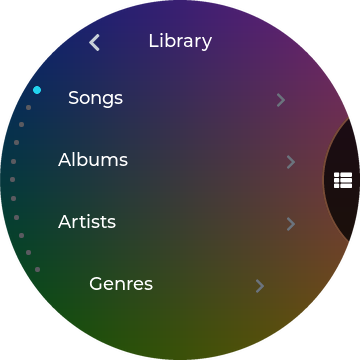
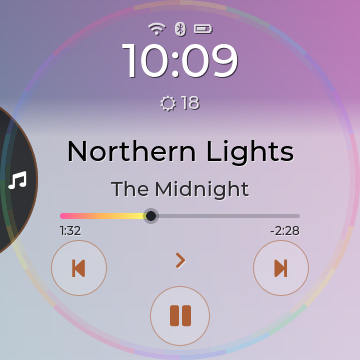
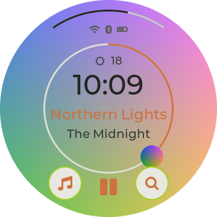
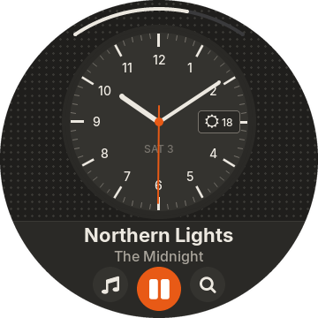

<h1 align="center">diskOS Disco!</h1>

> **Development builds on `dev` are experimental / in testing.** Use tagged releases for the published downloads. [Development notes](docs/DEV.md).

**Disco! 3.2.1:** Smoother wheel lists, depth for Disco's buttons, idle power-off that respects the charger, a safer power-button shutdown and a Queue fix — on top of 3.2.0's wheel lists, Shade, letter wheel and round track menus. [Release notes](docs/releases/v3.2.1.md) · [Changelog](CHANGELOG.md).

<p align="center">
  <b>Your music. Your kind of Disco.</b><br>
  A touch UI for the round screen of the FiiO Snowsky Disc, built on
  <a href="https://github.com/b0hemia/diskos">b0hemia's diskOS</a>.
</p>

<p align="center">
  
</p>

<p align="center">
  <a href="https://github.com/zmd22/diskos-disco/releases/latest"></a>
  
  
  <a href="ui/COPYING"></a>
</p>

<p align="center">
  <a href="docs/DISCO_TOUR.md"><b>Tour</b></a> ·
  <a href="docs/HOWTO.md"><b>How-to</b></a> ·
  <a href="https://github.com/zmd22/diskos-disco/releases/latest"><b>Download</b></a> ·
  <a href="#install">Install</a> ·
  <a href="docs/WINDOWS.md"><b>Windows</b></a> ·
  <a href="#updates-from-the-sd-card">SD updates</a> ·
  <a href="CHANGELOG.md">Changelog</a> ·
  <a href="https://zmd22.github.io/diskos-disco/">Website</a> ·
  <a href="#thanks">Thanks</a>
</p>


---

> [!CAUTION]
> **Best-effort hobby project, experimental, as-is, no liability.** Flashing rewrites the Disc's root filesystem;
> a power cut, a bad cable or an interrupted flash can leave it unbootable. Back up your music and keep the
> saved stock image somewhere safe before you start. Not affiliated with FiiO, Snowsky or Ingenic.

## New in 3.2.0

- **Wheel lists** (Display › your theme's settings › Scroll › *Wheel*, Disco/Squash/Null): the current row sits large in the middle of the screen, one row above it, smaller and greyer rows below that sink under a soft fade.
- **QS style › Shade** (Display › QS style, all themes): the pull from the top first shows what's playing — cover (tap: play/pause), previous and next, title and artist (tap: the album), progress, clock and battery. Pull again for the theme's Quick settings; swipe up to close.
- **Letter wheel and A–Z keypad**: hold the letter dot (or the rim scrollbar) and turn — clockwise forward, counter-clockwise back — while the list follows; or open the round A–Z keypad from the A–Z pill. Empty letters are dimmed.
- **Round track menus** on Music and in the Library: Favourite, Lyrics, Album, Artist, View queue, Info, +Queue, +Playlist around the song's cover.
- **One header line everywhere**, the same Play/Shuffle pills on every list, cleaner and band-free fades, **Auto-tag** in Song info.
- **Fixed:** idle power-off works again; text never scrolls up and down.
- **Battery:** the interface sleeps between touches and player events instead of polling constantly.

[3.2.0 release notes](docs/releases/v3.2.0.md)

## New in 3.1.0

A clearer Focus A–Z wheel (now the letter wheel), settings with one hierarchy across every theme, Light/Dark/Auto, track action sheets (now round track menus) and queue reliability fixes. [3.1.0 release notes](docs/releases/v3.1.0.md)

## Introduced in 3.0.0 — hello, Zune.

**Zune by [namastecoconut-imagined](https://github.com/namastecoconut-imagined/diskos-disco-zune/commits?author=namastecoconut-imagined).** Bold type, deep black and an accent you choose. The original theme’s design and implementation are the foundation; zmd22 gave it a little Disco integration and polish. Thank you for sharing this lovely new way to enjoy the Disc.

**Immersive 3.0** brings Zune the shared spinning-disc transition and transport overlay. Larger small text, balanced settings, configurable tap/double-tap/hold shortcuts, a modal accent volume dial and shared Wall/Coverflow album views round out the update. The website adds an interactive seven-screen Zune walkthrough in four accents, including Immersive with its transport controls open.

[Zune guide](docs/themes/zune.md) · [3.0.0 notes](docs/releases/v3.0.0.md) · [Release checklist](docs/RELEASE_3.0.0.md)

## Also included from 2.7.0

**Your music, to go.** Disc Shelf is now built in. Browse a Navidrome library or an SMB3 share, select what you want and download original files to the card. It follows Disco, Null and Squash, with familiar swipe selection and both letter pickers. Nothing syncs while the app is closed. New Navidrome files use `Artist/YYYY - Album/NN. Track name.ext`.

**Hold. Shuffle. Listen.** Set your menu hold action to **Shuffle!** to start the whole song library, return to Music and see “Happy listening!”. SongSphere also gets a themed preview with an explicit Open button, so browsing past it keeps you in control.

Downloads now show clearer progress and speed. Copy jobs temporarily disable Wi-Fi power saving when needed and restore the previous mode afterward. Batched SD writes reduce small-write overhead; an actual transfer-speed gain depends on your card and network. Navidrome has been tried on the Disc; SMB3 remains experimental pending real NAS testing.

[What’s new](docs/releases/v2.7.0.md) · [Set up Disc Shelf](docs/DISC_SHELF_INSTALL.md) · [Quick how-to](docs/HOWTO.md)

## Big. Bold. Squash.

**[Squash](docs/themes/squash.md)** is our warm, readable take on the round screen: large Nunito Bold text, charcoal or off-white with orange accents, and controls made for touch. Double-tap track text to play/pause, swipe to skip, and tap D! for a rising circular launcher. Eight editable Quick Settings and a clean bottom volume arc keep everyday actions close.

**Help is part of the interface.** Open **Settings → Help → How to** for one-topic pages. Contextual first-use hints and **Show hints again** live in **Display → Navigation**. Learning is saved separately in Squash, Disco and Null.

**Null stays pixel-perfect.** Its full section and customization options remain, alongside Disco, Ring and Braun. Each theme keeps its own look and preferences.

[Squash guide](docs/themes/squash.md) · [How-to](docs/HOWTO.md) · [Try the customizer](https://zmd22.github.io/diskos-disco/#yourway)

## The idea

The Snowsky Disc looks like a CD. Disco! leans into that. The playing album's cover fills the 360 px round
screen, sharp on **Music** and softly blurred and tinted behind every other screen. A faint CD-rainbow sheen
runs around the rim. Everything you touch sits on glass around a **navigation circle** that slides out of the
right edge (or the left: there's a left-handed mode).

Underneath it is all diskOS: b0hemia's installer, boot chain, signed updates, player and library. Disco!
replaces only what you see and touch.

<table>
<tr>
<td align="center" width="25%"><br><sub><b>Music</b>: cover, clock, weather, rainbow seek line</sub></td>
<td align="center" width="25%"><br><sub><b>Navigation circle</b>: your sections, your order</sub></td>
<td align="center" width="25%"><br><sub><b>Tap the title</b>: favourite, album, artist, queue, lyrics</sub></td>
<td align="center" width="25%"><br><sub><b>Progress arc</b>: seek around the rim</sub></td>
</tr>
<tr>
<td align="center"><br><sub><b>Quick Settings</b>: pull down from the top</sub></td>
<td align="center"><br><sub><b>Equalizer</b>: ten rainbow faders</sub></td>
<td align="center"><br><sub><b>Volume</b>: a rim arc you can drag</sub></td>
<td align="center"><br><sub><b>Weather</b>: now and the next 12 hours</sub></td>
</tr>
<tr>
<td align="center"><br><sub><b>Search</b>: artists first, then songs</sub></td>
<td align="center"><br><sub><b>Library</b>: lists that follow the curve</sub></td>
<td align="center"><br><sub><b>Standby</b>: redraws once a minute</sub></td>
<td align="center"><br><sub><b>Light</b> appearance, or automatic by time of day</sub></td>
</tr>
</table>

<details>
<summary>Earlier releases: SongSphere, Stats, Windows and more</summary>

## New in 2.2: SongSphere built in, Apps, a new Listening Stats

**SongSphere** is now part of diskOS: place albums, artists and songs by mood from the Library's hold menu or Music's
track popup, then play a mood. **Apps** puts up to five apps, with their icons, in the navigation circle.
**Listening Stats** gets swipeable periods, top 5s with a top 15 a tap away, and a Wrapped for each #1.
[2.2 release notes](docs/releases/v2.2.0.md)

**2.2.1** makes **USB DAC** play again on the latest firmware (it was silent) and fixes a few smaller things in
Listening Stats, SongSphere and Album Roulette. [2.2.1 notes](docs/releases/v2.2.1.md)

**2.2.2** brings a surprise and fixes the album covers in Listening Stats. [2.2.2 notes](docs/releases/v2.2.2.md)

**2.4.0** includes **Null**, a complete pixel theme, and **[Squash](docs/themes/squash.md)**, a readable orange-accented theme with a floating launcher and gesture controls. It focuses on polish and usability:
centred selectors, larger help, calmer library scrolling, contextual tooltips and full-page
How to guidance. [2.4.0 notes and final fixes](docs/RELEASE_2.4.0.md)

**2.3.0** drops the record into Immersive, adds gesture controls and hold-to-scrub, puts Quick Settings round the edge and makes Listening Stats bigger and bolder, with Highlights. [2.3.0 notes](docs/releases/v2.3.0.md)

<table><tr>
<td align="center" width="25%"><br><sub><b>SongSphere</b>: play by mood</sub></td>
<td align="center" width="25%"><br><sub><b>Apps</b> in the circle</sub></td>
<td align="center" width="25%"><br><sub><b>Stats</b>: swipe through time</sub></td>
<td align="center" width="25%"><br><sub><b>Wrapped</b> for each #1</sub></td>
</tr></table>

## New in 2.1: Listening Stats and SongSphere

**Listening Stats** shows your week, month or year in music: time, top artists, albums and songs, and when you
listen. **SongSphere**, a separate app, plays by mood: place your albums on a sphere, then drag to a mood and play.
Immersive gets Vinyl, CD or None and an option to hide the lyrics, in every theme. A touch on a dark screen now only
wakes it. [2.1 release notes](docs/releases/v2.1.0.md)

<table><tr>
<td align="center" width="25%"><br><sub><b>Stats</b>: your month at a glance</sub></td>
<td align="center" width="25%"><br><sub><b>Top artists</b>, albums and songs</sub></td>
<td align="center" width="25%"><br><sub><b>When you listen</b></sub></td>
<td align="center" width="25%"><br><sub><b>SongSphere</b>: play by mood</sub></td>
</tr></table>

## New in 2.0: install from Windows

**diskOS Disco! for Windows** installs Disco! on your Disc by clicking through four pages: it checks your PC, sets up
everything it needs, flashes the Disc and later makes your SD updates. No terminal, no Linux.
[What it does and how to use it](docs/WINDOWS.md) ·
**[Download it](https://github.com/zmd22/diskos-disco/releases/latest/download/diskOS-Disco-for-Windows.zip)**

<table><tr>
<td align="center" width="25%"><br><sub><b>1. Check</b> this PC</sub></td>
<td align="center" width="25%"><br><sub><b>2. Prepare</b> diskOS's environment</sub></td>
<td align="center" width="25%"><br><sub><b>3. Install</b> on the Disc</sub></td>
<td align="center" width="25%"><br><sub><b>4. Update</b> from the SD card</sub></td>
</tr></table>

Also in 2.0: no more false "Couldn't start playback" when a big playlist takes a moment to load. Everything from
1.5.0 is here too: [Boomshine](docs/DISCO_TOUR.md#boomshine), any app in the navigation circle, and landing pages.

All the details: [2.2.1 fixes](docs/releases/v2.2.1.md) · [2.2 release notes](docs/releases/v2.2.0.md) · [2.1](docs/releases/v2.1.0.md) · [2.0](docs/releases/v2.0.0.md) · [1.5.0](docs/releases/v1.5.0.md) · [changelog](CHANGELOG.md).

</details>

## Highlights

- **Listening Stats.** Your week, month or year in music, built in. [What it shows](docs/DISCO_TOUR.md#listening-stats).
- **SongSphere.** Play by mood: place albums, artists and songs on a sphere, then pick a mood. Built in.
  [How it works](docs/DISCO_TOUR.md#songsphere).
- **Apps.** Up to five apps, with their icons, in the navigation circle. [More](docs/DISCO_TOUR.md#apps).
- **Boomshine.** A built-in chain-reaction game: one tap, one blast, as many dots as you can catch.
  [How to play](docs/DISCO_TOUR.md#boomshine).
- **Album Roulette.** Too much music, nothing to play? Spin your collection: covers fly past, slow down and
  land on an album. Tap **Play!** to listen, hold the cover to spin again. Built in:
  [how it works](docs/DISCO_TOUR.md#album-roulette).
- **Disc Shelf.** Built-in Navidrome and SMB3 browsing with original-file downloads. Swipe to select; download missing files
  or explicitly replace Disc Shelf downloads. [Set it up](docs/DISC_SHELF_INSTALL.md), [take the tour](docs/DISCO_TOUR.md#disc-shelf).
- **Your apps in the menu.** Any installed app can sit in the navigation circle, with its own landing page.
- **Music is home.** Big title and artist (centred or from the left), the play mode one tap away, transport on an
  arc. Progress as a rainbow **line** under the title or an **arc** around the rim. Drag either to seek.
- **Tap the title** for Favourite, Album, Artist, Queue, Lyrics and Info. **Hold it** to go straight to the
  full-screen cover, or to favourite the song.
- **A queue that behaves.** *Add to queue* from any hold menu. Queued songs play next, in order, then your music
  carries on where it was.
- **Hold anything** in the library (song, album, artist, genre, file, folder) for its actions. A tap still plays.
- **Gestures with feedback.** Swipe from the edge to go back (left edge, or right in left-handed mode), swipe up
  from the bottom for Music, pull down for Quick Settings. A bubble fills with the accent colour once the swipe
  will count.
- **Readable on any cover.** Text and fades adapt to each album, and the accent colour follows the cover (or your
  own pick).
- **Display settings** let you choose the menu sections, clock, track times, track number, title position, font and hold,
  rim sheen, EQ / volume / progress colours, progress shape, Quick Settings, the side and the scroll style; the same
  menu in every theme ([map](docs/DISPLAY_SETTINGS.md)).
- **MA Sendspin** *(experimental)*: the Disc as a [Music Assistant](https://www.music-assistant.io/) speaker, with
  the track, cover and controls on Music. See the [tour](docs/DISCO_TOUR.md#ma-sendspin-experimental).
- **Safe updates.** Signed builds from the SD card install as a trial and roll back by themselves if they don't
  work out. FiiO's own interface is always one setting (or one held key) away.

Every screen, gesture and setting is in the **[tour](docs/DISCO_TOUR.md)**. Quick answers are in the
**[how-to](docs/HOWTO.md)**.

## Theme 02: Null

Null is second after Disco in the theme picker. Bold pixel type, blue/yellow or red/lime,
black or dark album backgrounds, and a sliding menu give it its own character. Quick
Settings offers text or familiar Disco icons with artwork, transport and side bars.

<table><tr>
<td align="center"><br>Music</td>
<td align="center"><br>Quick Settings</td>
<td align="center"><br>How to</td>
</tr></table>

Four font combinations include Matrix: large dot-matrix headings with terminal details.
Reorder the menu, choose text or icon QS, and set handle double-tap/hold shortcuts.
Null is right-handed. Both Disco and Null include one-topic How to pages and contextual
hints; selectors and explanations are larger, with room to read and tap.
See the [Null guide](docs/NULL_THEME.md) for the complete design and settings.

Building another theme? Start with the [theme authoring framework](themes.md): shared features, component hooks, scoped options and a focused acceptance checklist.

## Also included: Ring and Braun

Two more complete themes, with the same features and settings, are in **Settings › Display › Theme › Theme**.
**Their development is frozen:** they keep working and get fixes that apply to every theme, but no new changes;
new features land in Disco, Squash and Null.

<table>
<tr>
<td align="center" width="25%"><br><sub><b>Ring</b>: the progress ring is the interface</sub></td>
<td align="center" width="25%"><br><sub><b>Ring Light</b></sub></td>
<td align="center" width="25%"><br><sub><b>Braun</b>: Dieter Rams' SK4 radio</sub></td>
<td align="center" width="25%"><br><sub><b>Braun Dark</b></sub></td>
</tr>
</table>

Upstream's **Stone** theme is kept as well.

## Install

You need a Snowsky Disc on **FiiO firmware V2.57**, FiiO's official V2.57 firmware ZIP, a good USB data cable and
about 30 quiet minutes.

> [!IMPORTANT]
> **Recommended: start from FiiO's stock V2.57 firmware.** Installing over upstream diskOS or another diskOS build is not supported and can be buggy; restore stock first ([how](#going-back)).
> Coming from upstream diskOS? Going back to stock does not clear its settings; see [Known limits](#known-limits).
> Already running diskOS Disco!? Then you don't need to reinstall: [update from the SD card](#updates-from-the-sd-card).

### From Windows

Download **[diskOS-Disco-for-Windows.zip](https://github.com/zmd22/diskos-disco/releases/latest/download/diskOS-Disco-for-Windows.zip)**,
extract it and run `diskOS-Disco.exe`. It walks you through everything, including your update keys and later SD
updates. Full guide: **[diskOS Disco! for Windows](docs/WINDOWS.md)**.

> **Windows: unsupported, but working as intended: confirmed several times by users, installs and SD updates included.** The app always installs the latest release (or an `mq_ui` you pick).
> Start from FiiO's stock V2.57 firmware, not another diskOS build.
>
> **Used the Windows app before? Set it up again once.** Download the latest Windows app, open it and click
> **Set up again** on its setup page. Until then, an older app keeps installing the version it was first set up with.
> From 2.5.9 on, the app also updates itself to the latest release on every start.

### From macOS

Follow the **[macOS installation guide](docs/MACOS.md)**. Apple Silicon Macs can use the ready-built native flash tools from b0hemia/diskOS 1.2.0 with the Disco installer. Intel Macs build the tools once.

### From Linux

The installer is upstream diskOS's (`./diskos-installer --help`).

**0. Get it.** Download the **[latest release](https://github.com/zmd22/diskos-disco/releases/latest)** (Source
code, tar.gz) and unpack it, or `git clone https://github.com/zmd22/diskos-disco`. The ready-built interface is
already in it as `payload/mq_ui`; the release also has `mq_ui` on its own, with checksums, for SD-card
updates.

**1. Make your update keys (once, optional but recommended).** They let you install new builds from the SD card
later. Skip this and leave out `--ota-key` below if you only want to flash.

```sh
sh ui/tools/owner-keys/diskos-keys.sh          # creates ./diskos-keys/  (keep the private keys safe)
cp diskos-keys/diskos-root.pub.pem payload/
```

**2. Flash the public variant with Disco! and your key**

```sh
./install.sh                                   # first time only: host setup
./diskos-installer install \
  --firmware SNOWSKY_DISC_update_20260909_v257.zip \
  --variant public \
  --ui payload/mq_ui \
  --ota-key payload/diskos-root.pub.pem
```

Power the Disc off, hold **Volume Down** and plug in USB (the screen stays black). If you made keys, check the
summary line `ota: ON … key sha256 xxxx` before you answer `y`. It must match `sha256sum payload/diskos-root.pub.pem`.

> [!TIP]
> Use **public**, not dev. The dev variant's USB serial console takes the Disc's only USB device port, which
> blocks USB storage mode. Settings › System › Maintenance › Debug Mode still gives you SSH when you need it.

## Updates from the SD card

**On Windows:** the app's **Update** page downloads the latest version, signs it with your keys and writes it to the
SD card ([how](docs/WINDOWS.md#step-4--update-from-the-sd-card)). **On Linux:** download `mq_ui` from the [latest release](https://github.com/zmd22/diskos-disco/releases/latest) (or build it), then sign it with
your keys:

```sh
sh ui/tools/owner-keys/diskos-sign.sh path/to/mq_ui 2.0.0      # -> ./diskos-update/ (the label is free text)
```

Reuse the signing keys whose root public key was installed on this Disc. Copy the complete
`diskos-update` **folder** to the SD card root and safely eject the storage connection. On the Disc,
go to **Settings › System › Maintenance › Update from SD Card › Update**, wait for staging, then restart.

The new interface runs as a **trial**. Check Settings › System › About and leave it running for at
least three minutes. Confirmed playback can accept it automatically; otherwise choose **Keep**
when prompted, or **Go back** to revert. Restart after acceptance to confirm the kept build.
An unproven or failing trial rolls back. SD updates change the interface only, not the optional apps.
The **[full SD update guide](docs/UPDATING.md)** covers first-time keys, verification, folder contents,
epoch ordering, trial acceptance and troubleshooting.

## Build it yourself

```sh
cd ui
make CROSS=/opt/mipsel-n2008-musl-cross/bin/mipsel-linux-musl- mq_ui   # the Disc's binary
make CROSS= host-render                                                # desktop renderer for screenshots
make check-theme checkpunct                                            # style checks
```

The toolchain is musl-cross-make with [`ui/toolchain/mcm-config.mak`](ui/toolchain/mcm-config.mak) (MIPS32r2,
FP64, NaN2008, GCC 11.2). It reproduces upstream's binaries byte for byte. More is in
[docs/DEV_WORKFLOW.md](docs/DEV_WORKFLOW.md) and [ui/README.md](ui/README.md).

**Shortcuts for a fresh machine.** You don't have to build the compiler: a prebuilt copy is attached to the
[`toolchain-gcc11.2`](https://github.com/zmd22/diskos-disco/releases/tag/toolchain-gcc11.2) pre-release (unpack it
into `/opt`). Release builds use the helper, which builds from tracked files only and checks the result:

```sh
python3 ui/tools/build_device.py --toolchain /opt/mipsel-n2008-musl-cross --cache <cache dir> --out <new dir> --approved
```

Rebuilding a tagged release this way gives the same `mq_ui` as the one in the release. For screenshots, the
renderer's `preview-<page>` pages (Music, Quick Settings, Settings...) expect a cover picture next to the output:
`host-render PRESET VARIANT preview-home 0 out.ppm` reads `out.png` as the cover. Theme numbers: Stone 6, Ring 8,
Braun 9, Disco 10, Null 11, Squash 12; variant 0 is dark, 1 light. Keep the desktop and Disc builds in separate
checkouts.

## Known limits

- **Testing status.** Each release says what was tried on a real Disc and what was only checked on a computer.
  The newest features of a release usually need some days of everyday use; please report what you find.
- **Start from stock.** Install on FiiO's stock V2.57 firmware. Installing over upstream diskOS or another diskOS
  build is not supported and can be buggy.
- **Disc keeps starting stock after installing?** A "Default UI: Stock" choice made earlier (in Disco or upstream
  diskOS) is kept in the Disc's data area, which flashing and firmware updates don't erase, so every new install still
  starts stock. Hold **Volume Up** while powering on to start Disco once, then set **Settings > System > Controls >
  Default UI** to **diskOS**. No need to flash again.
- **Switching between diskOS builds.** Switched to Disco from upstream diskOS or another build, and something looks or behaves wrong? **Settings > System > Maintenance > Reset diskOS Settings** gives the interface a fresh start; your music, Wi-Fi, Bluetooth, EQ and audio settings stay. Going back to stock in between does *not* clear what diskOS leaves on the Disc.
- **Windows:** Unsupported, but working as intended: confirmed several times by users, installs and SD updates included.
- **Firmware.** Made for FiiO firmware V2.57 only.
- **Cover cache.** Covers for Cover Flow and lists are cached on the SD card only while it has enough free space
  (500 MB). On a nearly full card, covers may stay blank.
- **If you suddenly see FiiO's own interface,** Disco! stopped and the Disc fell back to the stock one; restart to
  return. Over SSH (Debug Mode), `/usr/data/diskos_boot.log` and `/usr/data/diskos_install.log` show why.
- **Languages.** Titles, artists and lyrics can be in Latin-script languages (including Vietnamese), Greek,
  Cyrillic, Thai, Korean, Japanese and common Chinese characters. Chinese, Japanese and Korean show in one smaller
  size. Right-to-left scripts (Hebrew, Arabic) and Indian scripts are not supported yet.
- **No online updates.** New versions come by signed SD-card update or a fresh install.

## Going back

Stock is never far:

- **Settings › System › Controls › Default UI › Stock** makes FiiO's interface the normal choice.
- Hold **Volume Up** from power-on to boot the other interface once.
- `./diskos-installer restore-stock` (Linux) puts the stock system back, using the backup made at install. Disco's
  settings stay in the Disc's data area (unused), so a later reinstall comes back with them. The Windows app keeps
  the backup in `%LOCALAPPDATA%\diskOS-Disco\backup`; keep a copy of it elsewhere too.

**What survives what** (flashing, restoring stock, FiiO updates, switching to upstream diskOS), and the fixes for the
usual surprises: [Flashing and switching interfaces](docs/SWITCHING.md).

## Documentation

| | |
|---|---|
| [Flashing and switching interfaces](docs/SWITCHING.md) | What stays and what goes when you flash, restore stock or switch |
| [Tour](docs/DISCO_TOUR.md) | Every screen, gesture and setting, with screenshots |
| [How-to](docs/HOWTO.md) | Short answers for everyday tasks |
| [Updating](docs/UPDATING.md) | Keys, signing, flashing once, troubleshooting |
| [macOS](docs/MACOS.md) | Install Disco on Apple Silicon or Intel Macs |
| [Windows](docs/WINDOWS.md) | diskOS Disco! for Windows: install and update from a Windows PC |
| [UI choices](docs/UI_CHOICES.md) | Why things look and work the way they do |
| [Changelog](CHANGELOG.md) | Every Disco! release, newest first |
| [All docs](docs/README.md) | Optional apps, hardware notes, developer workflow, legal |

## A note from zmd22

I’m out. Peace, and happy listening. Thank you to everyone who built, tested, shared and listened. Enjoy the music.

## Thanks

- **[namastecoconut-imagined](https://github.com/namastecoconut-imagined/diskos-disco-zune)**, for the original Zune theme: its Metro-inspired direction, typography, home menu, music screen and library presentation. The Disco adaptation builds on that design and implementation; zmd22’s follow-up focuses on integration, readability and controls. [Original author’s commits](https://github.com/namastecoconut-imagined/diskos-disco-zune/commits?author=namastecoconut-imagined).

- **[b0hemia](https://github.com/b0hemia/diskos)**, for diskOS itself: the reverse engineering, the installer,
  the boot and recovery chain, the signed-update design and the whole UI this project grew from. None of this
  exists without that work. If you enjoy diskOS, [support b0hemia on Ko-fi](https://ko-fi.com/b0hemia).
- **diskOS contributors**: everyone who reported, tested and patched upstream.
- **[ingvarr777](https://github.com/ingvarr777)**, for Ogg Opus support (diskOS PR #19) and the careful bug reports
  behind 1.4.1 (issues #1–#8).
- **[LVGL](https://lvgl.io)** for the graphics library, **SQLite**, **jsmn**, **musl**,
  **[musl-cross-make](https://github.com/richfelker/musl-cross-make)**, the **Inter**, **Montserrat** and
  **Font Awesome** fonts, and every project listed in [NOTICE.md](NOTICE.md).
- **Dieter Rams** and the Braun SK4, for the design language the Braun theme borrows with respect.
- FiiO / Snowsky for a lovely little round player. This project is **not affiliated with or endorsed by FiiO,
  Snowsky or Ingenic**.

### A note on the contributor list

Early commits in this repository show an author called "disco" because of a misconfigured author email; they
were made by the project's maintainer ([zmd22](https://github.com/zmd22)). The history is left as it is, since
rewriting it would break tags, links and existing clones.

## License

The installer, scripts and docs are **MIT** ([LICENSE](LICENSE)). The on-device interface in [ui/](ui/) is
**GPL-3.0-or-later** ([ui/COPYING](ui/COPYING)). Third-party terms are in [NOTICE.md](NOTICE.md),
[SPL_SOURCE.md](SPL_SOURCE.md) and [licenses/](licenses/).

> [!WARNING]
> Never share generated `diskos_*.bin` images: they contain FiiO's root filesystem. Share the installer and let
> people build from their own firmware.
