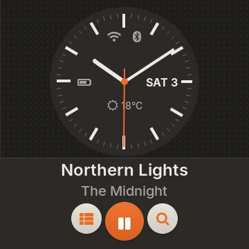
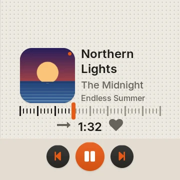
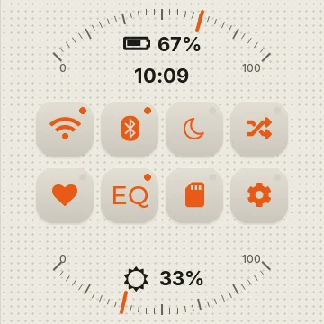

# Braun 2.0

Shipped in Disco 3.3.0 as preset 14. Choose **Settings → Display → Theme → Braun 2.0**. Classic Braun and existing preset IDs remain available.

## Shipped interface

- **Home:** analog wall clock with track information, date, weather, battery and radio status; lower navigation and transport keys.
- **Music:** choose **Art left** (straight tuning scale) or **Art on top** (rim tuning scale) under **Braun 2.0 settings → Music screen**. Both scales scrub with a time preview. **Controls** offers Buttons or Gestures; the gesture zone supports double-tap play/pause and swipes for next/previous.
- **Quick Settings:** up to eight icon keys in two rows of four, using the shared catalogue/editor and independent `braun2_qs_items`. Hold opens the item's shared detail action. Battery ticks run along the top rim; brightness runs along the bottom. Increasing brightness moves counterclockwise from lower-left 0% through bottom 50% to lower-right 100%, mapping hardware levels 4–40.
- **Volume:** classic Braun's right-rim dial and number box, with LO/HI gain switch and LED strip where firmware supports gain.
- **Menus and lists:** shaded squircle keys, orange icons and focus/state lamps, fitted headers, shared actions and navigation. Shortcuts has six slots; this is separate from the eight-key QS capacity.
- **EQ:** physical Braun faders with thin slots, ribbed caps and orange highlights; shared preset/editability behaviour.
- **Appearance:** light/dark/auto, fixed orange accent and Inter text with icon fallbacks. Body text follows Font Size; large clocks and figures retain their layout sizes. Background dots remain behind every screen, including standby; panels and artwork keep solid backing for contrast.
- **Standby:** shared saver choices remain available; the analog saver hides seconds and updates hands once per minute. No vertical text scrolling is introduced.

The [original design brief](BRAUN2_GUIDE.md) records alternatives, not shipped options. In particular, its four/six-key QS, artwork-free Music default and optional accent picker were superseded by the interface above.

## Representative previews

Only three representative images are retained here, shared with the website. They are host previews with sample music, not a complete screen-validation record. Their original capture commit was not recorded.

## Screen and subscreen coverage

| Family | Treatment |
|---|---|
| Home, Music, QS, volume | Dedicated Braun 2.0 layouts and dial scales |
| Library, albums/artists/songs/genres, playlists, queue, Up Next, favourites, folders, books/chapters | Shared data and navigation; warm pills, larger typography, Braun focus lamps and grille |
| Settings and nested groups/details | Larger category rows, safe inset back knob/header, neutral cards, switches, sliders, rollers and keyboards |
| EQ presets, user/built-in/off band editor | Original Braun's ten physical faders, slot/zero/cap roles, shared editability guards and preset writes |
| Wi-Fi/Bluetooth and details, output modes, MA, Last.fm | Shared connection actions; Braun surfaces, knobs, state pointers, palette and grille |
| Song Info, lyrics, playback menu, track/file/group actions, confirmations, toasts | Shared actions; warm panels, neutral text, rounded controls and appropriate destructive state colour |
| Weather, battery/usage, date/time, debug/help/maintenance | Existing functional instruments with Braun roles, typography and persistent dots |
| Apps/chooser/landing, Stats and its ranked/wrapped views, Roulette/spin, SongSphere, Disc Shelf | Shared app content with Braun kit and grille; dashboard blocks remain dashboard blocks rather than being restyled as oversized list pills |
| Standby, immersive, shutdown | Braun roles and grille behind content; shared wake, playback and shutdown behaviour |

## Build and validation record

The [release record](../RELEASE_3.3.0.md) documents the fresh static MIPS build and owner test builds. `python3 tools/check-release.py --tag v3.3.0` checks the visible version, tracked UI source hash, static MIPS ELF and payload checksum. It does not independently reproduce compilation or prove physical-device behaviour.

The development host checks are `ui/tests/braun2_test.py` (appearance/text-size cases, shared controls and QS editor) and `ui/tests/theme_compat_test.py`. `ui/tests/braun2_renders.py` generates the broader screen/appearance inventory locally; these generated captures are not committed as release screenshots. Earlier iteration sheets and incomplete Stats recaptures have been removed.

Physical-device touch, standby power, wake and audio/EQ acceptance should be recorded separately from host checks. The release's owner-testing statement does not itemize all those checks.
