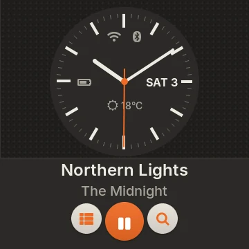
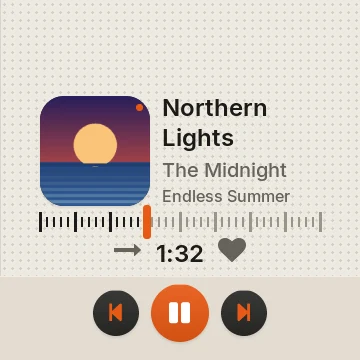
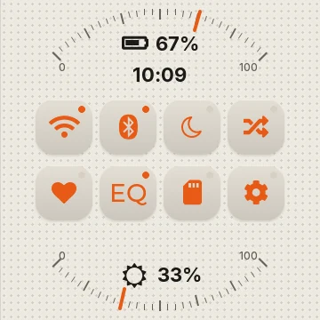

# Braun 2.0

Added in 3.3.0 (preset 14). **Settings › Display › Theme › Braun 2.0**. Classic Braun remains available.

## Interface

- **Home:** analog wall clock with track, date, weather, battery and radio status; navigation and transport keys below.
- **Music:** **Art left** (straight tuning scale) or **Art on top** (rim scale), under **Braun 2.0 settings › Music
  screen**. Both scrub with a time preview. **Controls:** Buttons or Gestures (double-tap play/pause, swipe to skip).
- **Quick Settings:** up to eight keys in two rows (`braun2_qs_items`, shared editor); hold opens the item's detail.
  Battery ticks on the top rim; brightness on the bottom rim, counterclockwise from lower-left 0% to lower-right 100%
  (hardware levels 4–40).
- **Volume:** classic Braun right-rim dial and number box, LO/HI gain switch and LED strip where gain is supported.
- **Menus and lists:** shaded squircle keys, orange icons and state lamps. Shortcuts has six slots (separate from QS).
- **EQ:** Braun faders with ribbed caps and orange highlights.
- **Appearance:** Light/Dark/Auto, fixed orange accent, Inter with icon fallbacks. Body text follows Font Size; large
  clocks and figures keep fixed sizes. Background dots on every screen; panels and artwork have solid backing.
- **Standby:** shared saver choices; the analog saver omits seconds and updates once a minute.

The [design brief](BRAUN2_GUIDE.md) lists explored alternatives (four/six-key QS, artwork-free Music, accent picker)
that didn't ship.

## Previews

Host renders with sample music (capture revision not recorded):

## Coverage

| Screens | Treatment |
|---|---|
| Home, Music, QS, volume | Dedicated layouts and dial scales |
| Library views, playlists, queue, Up Next, favourites, folders, books | Shared logic; warm pills, larger type, focus lamps, grille |
| Settings | Larger rows, inset back knob/header, neutral cards and controls |
| EQ | Ten faders, shared editability guards |
| Wi-Fi, Bluetooth, outputs, MA, Last.fm | Shared actions; Braun surfaces and knobs |
| Song Info, lyrics, menus, confirmations, toasts | Shared actions; warm panels, destructive-state colour |
| Weather, battery, date/time, debug, help, maintenance | Existing instruments with Braun roles |
| Apps, Stats, Roulette, SongSphere, Disc Shelf | Shared content with Braun kit; dashboards keep their layout |
| Standby, Immersive, shutdown | Braun roles and grille behind content |

## Validation

- Build record: [RELEASE_3.3.0.md](../RELEASE_3.3.0.md). `tools/check-release.py --tag v3.3.0` checks version, UI
  source hash, static MIPS ELF and payload checksum; it doesn't reproduce the build or test the device.
- Host tests: `ui/tests/braun2_test.py`, `ui/tests/theme_compat_test.py`. `ui/tests/braun2_renders.py` generates the
  full render set locally (not committed).
- On-device touch, standby power, wake and audio/EQ results aren't itemised here.
