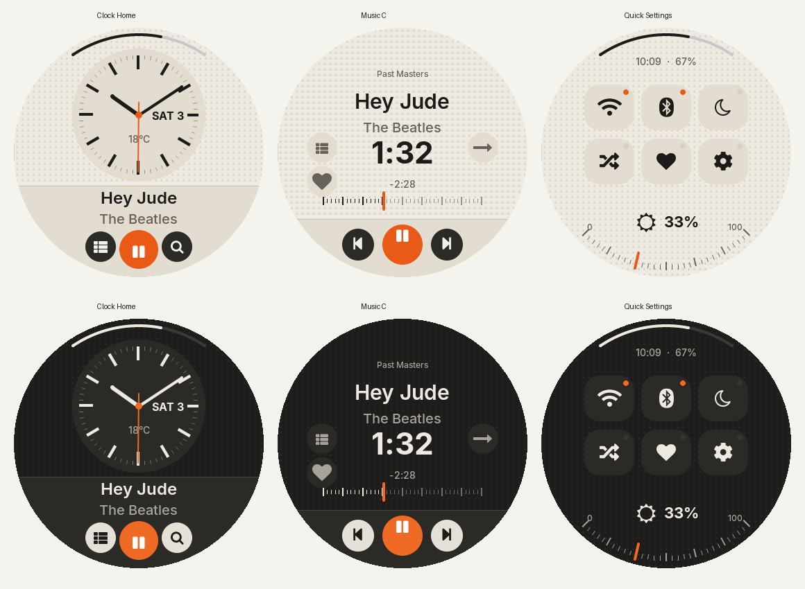

# Braun 2.0

A separate light/dark native LVGL preset, appended as ID 14. Choose **Display → Theme → Braun 2.0**. Existing preset IDs and classic Braun remain intact.

## Implemented choices

- Clock Home: analog clock, larger 24 px track and 20 px artist, enlarged date/weather, three lower transport/navigation knobs.
- Music C: type-first layout without artwork, 30 px title, 20 px artist, 44 px elapsed time, remaining time, horizontal tuning scale with played ticks and an orange draggable needle. Mode, favourite/sleep and queue actions retain their shared handlers.
- Quick Settings: six icon-only rounded keys in two rows, shared catalogue and editor, independent `braun2_qs_items` selection. Default: Wi-Fi, Bluetooth, sleep, shuffle, favourites and settings. Hold reveals the shared item's detail action.
- Brightness replaces volume on the lower QS rim. Increasing brightness moves **counterclockwise**: lower-left 0%, bottom 50%, lower-right 100%. Percent maps the existing hardware control range 4–40. The control uses a 44 px band and a distinct orange needle.
- Warm ivory/charcoal semantic palettes, fixed orange accent, neutral tactile knobs and pills. Background dots remain on **every screen, including standby**, overriding the guide's standby exception. Panels and artwork retain their solid backing for contrast.
- Six shared standby styles remain available; the analog style hides seconds and updates its hands once per minute. Text truncates; no vertical text scrolling is introduced.

The supplied [guide](BRAUN2_GUIDE.md) is the reference brief; the choices above override its alternative layout defaults.

## Polish pass

- Fonts: every text role the theme uses is Inter (22, 24, 26/28, 36, date and standby clock were Montserrat). Icon glyphs in Inter text fall back to the shared icon faces, as in Zune. The 44 px time font gains a real colon (`font_inter_bold_44_colon.c`, chained by `br_font()`), so `1:32` no longer shows a 20 px colon. Classic Braun benefits from the same colon.
- Cards: the styler no longer turns round objects (artwork, discs) into rounded squares.
- Song info: a 96 px rounded artwork tile filled edge to edge, no progress ring behind it; 22/16 px title/artist and 14/16 px details.
- EQ editor: Braun sliders with orange highlights: thin slots, dark ribbed caps, an orange run from 0 dB to each cap, and the selected cap in orange. The preset pill is 14 px bold and fits its name.
- EQ presets: the name steps down a size and ends in an ellipsis instead of clipping mid-scroll; On is the orange primary key again.
- Headers: the cap is shorter so it no longer overlaps the first row of lists and Settings.
- Home: smaller face with hands to match, the date in a window left of 3 o'clock, weather as a quiet line under the hub.
- Music: elapsed time no longer wraps, transport glyphs are centred, and queue/mode/favourite/sleep are matching 44 px panel knobs.
- Standby, Queue: Inter type on standby; Queue's Play stays orange.

Renders were regenerated after this pass (142 of 146 captures). Stats and its landing view need a writable `/usr/data` on the host and were not recaptured; their committed images are from the first pass.

## Screen and subscreen coverage

| Family | Treatment |
|---|---|
| Home, Music, QS, volume | Dedicated Braun 2.0 layouts and dial scales |
| Library, albums/artists/songs/genres, playlists, queue, Up Next, favourites, folders, books/chapters | Shared data and navigation; warm pills, larger typography, Braun focus lamps and grille |
| Settings and nested groups/details | Larger category rows, safe inset back knob/header, neutral cards, switches, sliders, rollers and keyboards |
| EQ presets, user/built-in/off band editor | Original Braun's ten physical faders, slot/zero/cap roles, shared editability guards and preset writes |
| Wi-Fi/Bluetooth and details, output modes, MA, Last.fm | Shared connection actions; Braun surfaces, knobs, state pointers, palette and grille |
| Song Info, lyrics, playback menu, track/file/group actions, confirmations, toasts | Shared actions; warm panels, neutral text, rounded controls and appropriate destructive state colour |
| Weather, battery/usage, date/time, debug/help/maintenance | Existing functional instruments with Braun roles, typography and persistent dots |
| Apps/chooser/landing, Stats and its ranked/wrapped views, Roulette/spin, SongSphere, Disc Shelf | Shared app content with Braun kit and grille; dashboard blocks remain dashboard blocks rather than being restyled as oversized list pills |
| Standby, immersive, shutdown | Braun roles and grille behind content; shared wake, playback and shutdown behaviour |

## Validation

- Host build: `make -C ui CROSS= host-render -j1`.
- `python ui/tests/braun2_test.py`: six passing appearance/text-size cases. Real LVGL pointer touches verify brightness endpoints 4 → 22 → 40 along the lower rim; tests cover six-key hit sizes, every catalogue icon, Wi-Fi tap/hold, previous-track transport, native seek controller, shared editor reorder/persistence/empty state and theme selection isolation.
- `python ui/tests/theme_compat_test.py`: passed schema compatibility, optional-role fallback and rejection checks.
- `python ui/tests/braun2_renders.py`: 146 successful production captures: 48 registered screens in each appearance, plus 25 stateful subscreens per appearance. Fixtures supply sample music, radio peers and stats; no live device is used. Blank content in unseeded database views is not evidence of populated-content validation.
- Broader `settings_alignment_test.py` fails at Stone's Display ordering (`Light / dark` preceding `Immersive`). The same failure was reproduced with the original base revision's sources in a separate host build. It is not fixed in this theme change.

The [dark](braun2-renders/overview-0.png) and [light](braun2-renders/overview-1.png) sheets cover all registered screens. A compact set of full-size images is committed; run the renderer to reproduce all images listed in `manifest.json`.

This is source and host validation. A MIPS cross build and physical-device touch, standby power, wake and audio/EQ checks remain outstanding; no firmware payload is replaced or flashed.
